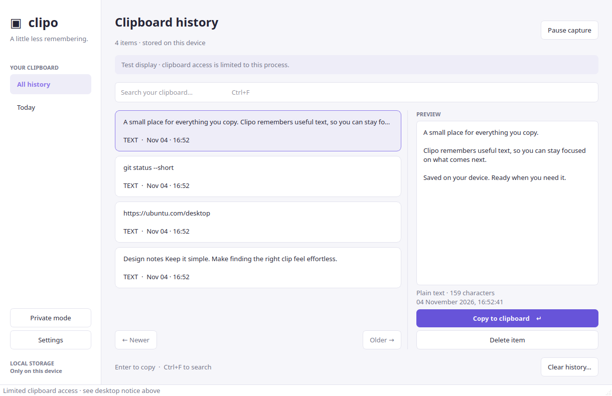

# Clipo

A native Linux clipboard manager built with Python 3.11+, PySide6 / Qt 6,
and SQLite. Ubuntu is the primary target.

**Current release: 0.1.0 — Phase 1 implementation.** This is the tested foundation
for the larger product, not the completed CopyQ-level application. Real Ubuntu
desktop acceptance testing is still required before a production release.



## What works now

- Event-driven text capture through Qt's clipboard API.
- Persistent local SQLite history, with timestamps and consecutive deduplication.
- Exact text restore (including whitespace, Unicode, and multiline text).
- Literal substring search, Today filter, and paginated history.
- Full text preview; large previews are bounded and explicitly labeled.
- Delete one item or confirm clearing all saved history.
- Configurable history limit (default 1,000; zero means unlimited).
- Pause capture and private mode, both preserved across restarts.
- Password manager exclusion hints for KeePassXC and supported MIME markers.
- Light, dark, and system appearance; keyboard navigation and Ctrl+F search.
- Background storage worker; SQLite operations do not run on the UI thread.
- Tray integration when the desktop supports it. Closing the window then keeps
  Clipo running; use the tray's Quit action or Ctrl+Q to exit. Without a tray,
  closing the window quits so the app never becomes inaccessible.
- Single-instance activation: launching again opens the existing window.

No demonstration clipboard entries are inserted on startup. The screenshot uses
synthetic example text in a separate temporary database.

## Run on Ubuntu

Ubuntu 24.04+ provides a suitable Python version. On a fresh installation:

```bash
sudo apt update
sudo apt install python3-venv libegl1 libgl1 libxkbcommon-x11-0 libxcb-cursor0 libxcb-icccm4 libxcb-keysyms1 libxcb-shape0 libxcb-xinerama0
python3 -m venv .venv
.venv/bin/python -m pip install -e '.[test]'
.venv/bin/clipo
```

The checked-out project already has a virtual environment with dependencies
installed in this development workspace. Start it with `.venv/bin/clipo`.

Optional application-menu launcher (run after installing dependencies):

```bash
.venv/bin/python scripts/install_desktop.py
```

Then find **Clipo** in Ubuntu's application menu. The launcher points at this
checkout's virtual environment, so keep this folder in place. Remove the launcher
with `.venv/bin/python scripts/install_desktop.py --uninstall`; history is preserved.
This development launcher is not a `.deb` installer. Debian and AppImage packaging
belong to Phase 6.

To experiment without your regular history or settings:

```bash
.venv/bin/clipo --data-dir /tmp/clipo-sandbox
```

## Clipboard compatibility

**X11:** Qt's event-driven clipboard backend is used. An Ubuntu on Xorg session is
the target for Phase 1 background capture. The PRIMARY selection is intentionally
not recorded; use explicit Copy / Ctrl+C.

**Wayland (including XWayland):** background capture is **limited and unverified**.
Clipo displays a persistent warning and only records events delivered by Qt.
Running with `QT_QPA_PLATFORM=xcb` inside a Wayland session does not establish
full Wayland clipboard support. No compositor-wide data-control integration is
implemented yet. The next platform work must evaluate ext-data-control /
wlr-data-control where available, GNOME-specific integration, and portal
capabilities. A foreground event is not proof of background monitoring support.

The app does not automatically paste into another application: select an item,
click **Copy to clipboard** (or press Enter in the list), switch apps, and paste.
No system-wide keyboard shortcut is registered in this phase.

Qt references: [QClipboard](https://doc.qt.io/qtforpython-6/PySide6/QtGui/QClipboard.html)
and [QSystemTrayIcon](https://doc.qt.io/qtforpython-6/PySide6/QtWidgets/QSystemTrayIcon.html).

## Data and privacy

- History: `$XDG_DATA_HOME/clipo/history.sqlite3`, normally
  `~/.local/share/clipo/history.sqlite3`.
- Settings: `$XDG_CONFIG_HOME/clipo/settings.json`, normally
  `~/.config/clipo/settings.json`.
- Data/config directories use mode `0700`; database/settings files use `0600`.
- All supported captured text is stored **unencrypted**. General API-key/password
  detection and encryption are not implemented yet. Use private mode before
  copying credentials. Common password-manager MIME hints are skipped, but this
  cannot identify all sensitive text.
- Private mode and pause stop new captures. Resuming does not ingest text copied
  while recording was off. Existing history remains available.
- The app does not read the preexisting clipboard at startup, upload contents,
  automatically execute text, or log clipboard contents.
- Maximum text payload defaults to 1 MiB; oversized text is rejected with a status
  message and is never truncated in storage. `max_text_bytes` may be changed in
  the JSON settings within 1 KiB–16 MiB until the advanced settings UI is built.
- Clear/delete remove records logically. SQLite WAL, backups, SSDs, and filesystem
  snapshots mean secure erasure is not guaranteed.
- Images, file lists, and image-bearing MIME data are skipped in Phase 1. Plain
  text URLs are captured as text; rich formatting is not preserved.

## Tests

```bash
QT_QPA_PLATFORM=offscreen .venv/bin/python -m pytest -q
```

Tests use a process-local clipboard or a controlled external-event test double;
they do not modify your desktop clipboard. Coverage includes storage, exact text
integrity, limits, literal search, pagination, deletion, persistence, privacy,
password-manager hints, capability reporting, Qt clipboard restore, and the
worker-to-window flow. These checks are not a substitute for cross-application
X11/Wayland tests on Ubuntu. See [the manual checklist](docs/UBUNTU_TESTING.md).
The full suite passed 26 tests with local Unix sockets permitted; sandboxed
environments that block them skip the activation test. Native Wayland startup
and clean shutdown also passed. See [validation evidence](docs/VALIDATION.md).

## Architecture and next steps

See [architecture](docs/ARCHITECTURE.md) and [the roadmap](docs/ROADMAP.md).
The next phase adds images, favorites, pinning, collections, and tags. QR, OCR,
snippets, global shortcuts, advanced privacy/search, and distribution follow in
their specified phases; no nonfunctional controls for those features are shown.
